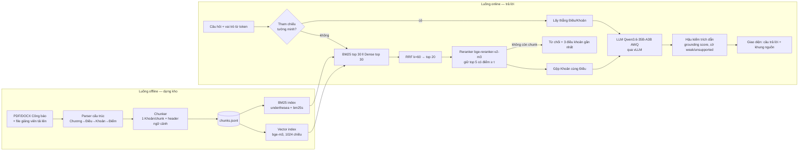

# Báo cáo kỹ thuật — ViLex-ANND

**Trợ lý ảo hỏi–đáp văn bản quy phạm về khoa học, công nghệ và đổi mới sáng tạo, ứng dụng mô hình ngôn ngữ lớn triển khai nội bộ**

> Tài liệu nguồn để viết bài sáng kiến. Cập nhật ngày 04/11/2026.
> Mọi con số trong tài liệu này là **số đo thật** từ mã nguồn, log chạy và kết quả kiểm thử. Mục nào chưa có số liệu được ghi rõ **“chưa chạy”** — không điền ước lượng vào bài.

---

## Mục lục

1. [Tóm tắt](#1-tóm-tắt)
2. [Bài toán và mục tiêu](#2-bài-toán-và-mục-tiêu)
3. [Chức năng của hệ thống](#3-chức-năng-của-hệ-thống)
4. [Nhiệm vụ và tiến độ](#4-nhiệm-vụ-và-tiến-độ)
5. [Kiến trúc tổng thể](#5-kiến-trúc-tổng-thể)
6. [Backbone — các mô hình sử dụng](#6-backbone--các-mô-hình-sử-dụng)
7. [Huấn luyện và hiệu chỉnh](#7-huấn-luyện-và-hiệu-chỉnh)
8. [Dữ liệu và tiền xử lý](#8-dữ-liệu-và-tiền-xử-lý)
9. [Pipeline truy xuất](#9-pipeline-truy-xuất)
10. [Sinh câu trả lời và chống ảo giác](#10-sinh-câu-trả-lời-và-chống-ảo-giác)
11. [Tài khoản, phân quyền, bảo mật](#11-tài-khoản-phân-quyền-bảo-mật)
12. [Hội thoại và bổ sung dữ liệu](#12-hội-thoại-và-bổ-sung-dữ-liệu)
13. [Hạ tầng triển khai và tài nguyên GPU](#13-hạ-tầng-triển-khai-và-tài-nguyên-gpu)
14. [Kết quả thu được](#14-kết-quả-thu-được)
15. [Mã nguồn](#15-mã-nguồn)
16. [Hạn chế và hướng phát triển](#16-hạn-chế-và-hướng-phát-triển)
17. [Gợi ý dùng cho bài sáng kiến](#17-gợi-ý-dùng-cho-bài-sáng-kiến)
18. [Tài liệu tham khảo](#18-tài-liệu-tham-khảo)

---

## 1. Tóm tắt

ViLex-ANND là hệ thống hỏi–đáp tiếng Việt về văn bản quy phạm pháp luật trong lĩnh vực khoa học, công nghệ và đổi mới sáng tạo (KH,CN&ĐMST), xây dựng theo kiến trúc **RAG (Retrieval-Augmented Generation — sinh câu trả lời có truy xuất)**. Người dùng hỏi bằng ngôn ngữ tự nhiên; hệ thống tìm các Điều/Khoản liên quan trong kho văn bản, rồi để mô hình ngôn ngữ lớn (LLM) viết câu trả lời **chỉ dựa trên các điều khoản đó**, mỗi ý gắn nhãn trích dẫn `[n]` trỏ về nguyên văn.

Điểm khác biệt so với chatbot thông thường:

| # | Nguyên tắc | Hiện thực trong hệ thống |
|---|---|---|
| 1 | **Xử lý hoàn toàn nội bộ** | LLM, mô hình embedding, reranker đều là mô hình mở (open-weight), chạy trên GPU của đơn vị; không gọi API bên ngoài |
| 2 | **Có căn cứ hoặc im lặng** | Không đủ căn cứ (điểm reranker < ngưỡng τ) thì không gọi LLM, trả câu từ chối chuẩn; hậu kiểm từng câu trả lời |
| 3 | **Chia theo cấu trúc pháp lý** | Cắt văn bản theo Chương → Điều → Khoản → Điểm, không cắt theo số ký tự → trích dẫn luôn trỏ đúng điều khoản |
| 4 | **Truy xuất lai** | Tra trực tiếp theo số Điều + BM25 + vector ngữ nghĩa + xếp hạng lại (reranker) |
| 5 | **Phân quyền theo vai trò** | Học viên chỉ thấy văn bản công khai; giảng viên thấy thêm tài liệu nội bộ; lọc trước khi truy xuất |

**Trạng thái (04/11/2026):** hệ thống chạy đầy đủ trên 1 GPU NVIDIA A100 40GB (Google Colab); kho gồm 11 văn bản pháp luật thật lấy từ Công báo + 1 văn bản nội bộ giả lập; 76 bài kiểm thử tự động đạt; giao diện web hoàn chỉnh (đăng nhập, nhiều hội thoại, thêm dữ liệu). Đã đánh giá định lượng trên tập test 45 câu (mục 14.4): Recall@5 = 0,974; có RAG đúng hoàn toàn 41/45 câu (91,1%) so với 1/45 (2,2%) khi không có RAG; không bịa điều khoản; từ chối đúng 7/7 câu ngoài phạm vi.

---

## 2. Bài toán và mục tiêu

**Vấn đề thực tiễn**

- Từ 2025–2026 có nhiều văn bản mới về KH,CN&ĐMST: Luật 93/2025/QH15, Luật Giáo dục đại học 125/2025/QH15, chùm Nghị định 262–268/2025, Nghị định 125/2026/NĐ-CP (thay thế NĐ 109/2022), Thông tư 44/2026/TT-BGDĐT… Tra cứu thủ công tốn thời gian, dễ nhầm văn bản đã hết hiệu lực.
- Các công cụ AI công cộng không phù hợp để dùng với tài liệu ngành (dữ liệu bị gửi ra ngoài).
- LLM “trần” không biết văn bản ban hành sau thời điểm huấn luyện (NĐ 125 ban hành 06/04/2026) nên dễ bịa hoặc trả lời theo văn bản cũ.

**Mục tiêu**

1. Tra cứu nhanh bằng câu hỏi tự nhiên, câu trả lời có căn cứ tới Điều/Khoản.
2. Chạy hoàn toàn nội bộ, không phụ thuộc dịch vụ bên ngoài.
3. Phân quyền theo đối tượng, ghi log để kiểm toán.
4. Có số liệu thử nghiệm thật để chứng minh hiệu quả.

**Ngoài phạm vi bản demo:** văn bản nội bộ/mật thật, đăng nhập tích hợp hệ thống của đơn vị, OCR văn bản scan, huấn luyện/fine-tune mô hình.

---

## 3. Chức năng của hệ thống

### 3.1 Người dùng cuối

| Chức năng | Mô tả | Vai trò |
|---|---|---|
| Trang chào mừng | Giới thiệu, minh hoạ câu trả lời có trích dẫn, số văn bản/điều khoản và ngày cập nhật kho | Mọi người |
| Đăng nhập | 2 loại tài khoản; sai mật khẩu báo lỗi; phiên đăng nhập 12 giờ | Mọi người |
| Hỏi–đáp | Trả lời streaming (hiện dần từng chữ), mỗi ý gắn chip `[n]`; bấm chip → khung phải mở đúng Khoản, tô sáng | Cả hai |
| Tìm điều khoản | Chỉ truy xuất, không sinh câu trả lời — trả danh sách điều khoản liên quan | Cả hai |
| Tra cứu trực tiếp | Gõ “Điều 7 Nghị định 125”, “khoản 2 Điều 9 NĐ 125/2026” → lấy thẳng điều khoản, không qua tìm kiếm | Cả hai |
| Từ chối có căn cứ | Câu ngoài phạm vi → “Các văn bản hiện có không quy định…” + 3 điều khoản gần nhất | Cả hai |
| Chỉ báo độ tin cậy | Thanh *grounding score*; câu thiếu căn cứ bị gạch chân vàng; độ trễ 3 giai đoạn | Cả hai |
| Nhiều hội thoại | Tạo mới, mở lại, đổi tên, xoá; câu hỏi nối tiếp hiểu theo ngữ cảnh hội thoại | Cả hai |
| Kho văn bản | Danh sách văn bản, lọc, chọn phạm vi tra cứu, xem mục lục theo Chương và nguyên văn từng Điều | Cả hai (theo quyền) |
| Thêm dữ liệu | Tải lên Word (.docx), PDF có chữ, .txt, .md; chọn công khai/nội bộ; dùng được ngay | **Giảng viên** |
| Xoá dữ liệu đã thêm | Xoá văn bản do giảng viên tải lên (không xoá được kho gốc) | **Giảng viên** |
| Đánh giá câu trả lời | 👍/👎, sao chép câu trả lời kèm trích dẫn | Cả hai |

### 3.2 Quản trị / nghiên cứu

- Nạp kho văn bản (`ingest`) với kiểm tra số Điều theo danh mục.
- Dựng chỉ mục BM25 + vector (`build_index`), tự nhận biết chỉ mục lỗi thời.
- Bộ script đánh giá: ablation truy xuất, có/không RAG, dò ngưỡng τ, sinh báo cáo + biểu đồ.
- Log JSONL mọi truy vấn: thời gian, người dùng, vai trò, câu hỏi, chunk được dùng, độ trễ.

---

## 4. Nhiệm vụ và tiến độ

Theo bảng nhiệm vụ T1–T10 của kế hoạch (`docs/PLAN.md` mục 9.2):

| # | Nhiệm vụ | Tiêu chí nghiệm thu | Trạng thái |
|---|---|---|---|
| T1 | Khung repo, `config.yaml`, schema Pydantic | `pytest` chạy, schema validate chunk mẫu | ✅ Đạt |
| T2 | Parser + chunker + ingest | Số Điều parse khớp registry mọi văn bản | ✅ Đạt — 12/12 văn bản khớp (516 Điều) |
| T3 | BM25 + tra cứu trực tiếp | 5 câu tham chiếu trực tiếp đúng Điều; BM25 hợp lý | ✅ Đạt (kiểm thử tự động) |
| T4 | RRF + hậu kiểm trích dẫn + unit test | Test RRF; test parse `[n]`, gắn cờ câu không nhãn | ✅ Đạt |
| T5 | Dense, rerank, build index trên Colab | Index trên Drive; truy xuất < 1 giây | ✅ Đạt — truy xuất + rerank p50 ≈ 57 ms (mục 14.3) |
| T6 | LLM client, prompt, vLLM | 5 câu có `[n]`; câu ngoài phạm vi bị từ chối | ✅ Đạt trên A100 (mục 14.3) |
| T7 | API FastAPI + SSE + log + tunnel | Đủ 4 loại event; `/api/health` xanh | ✅ Đạt (`status: ok`, LLM `ok: true`) |
| T8 | Frontend | Chạy trọn luồng qua URL tunnel | ✅ Đạt; bổ sung đăng nhập, nhiều hội thoại, thêm dữ liệu |
| T9 | Bộ câu hỏi + 3 script đánh giá + report | 3 file CSV + 2 biểu đồ + `report.md` | ✅ Đạt — đã chạy trên Colab và chấm xong 04/11/2026 (mục 14.4) |
| T10 | Hardening demo, video | Video 2–3 phút; demo 3 lần liên tiếp không lỗi | ⏳ Câu gợi ý + xử lý lỗi mạng đã có; video chưa quay |

---

## 5. Kiến trúc tổng thể

Hệ thống có hai luồng: **offline** dựng kho khi có văn bản mới, và **online** trả lời từng câu hỏi.



**Thành phần phần mềm**

| Lớp | Công nghệ |
|---|---|
| Giao diện | Vite 5 + React 18 + TypeScript + Tailwind CSS; `react-markdown`; `@microsoft/fetch-event-source` (SSE qua POST); font Be Vietnam Pro đóng gói cục bộ |
| API | FastAPI + Uvicorn; streaming Server-Sent Events; Pydantic v2 |
| Truy xuất | `bm25s`, `underthesea`, `sentence-transformers`, `transformers` (PyTorch), ma trận NumPy (không cần vector DB) |
| Phục vụ LLM | vLLM 0.33 (API kiểu OpenAI); dự phòng llama.cpp `llama-server` (GGUF) |
| Hạ tầng demo | Google Colab, GPU A100 40GB, Google Drive (lưu mã, index, cache), Cloudflare quick tunnel |

---

## 6. Backbone — các mô hình sử dụng

Hệ thống **không tự xây dựng mô hình**; dùng các mô hình mã nguồn mở đã huấn luyện sẵn, mỗi mô hình một vai trò.

### 6.1 Mô hình ngôn ngữ lớn (sinh câu trả lời)

| Thuộc tính | Giá trị |
|---|---|
| Mô hình | **Qwen3.6-35B-A3B** (Alibaba Qwen), bản lượng tử hoá 4-bit **AWQ** của cộng đồng: `QuantTrio/Qwen3.6-35B-A3B-AWQ` (Qwen chưa phát hành bản AWQ chính thức; chọn bản có nhiều lượt tải nhất) |
| Kiến trúc | Mixture-of-Experts (MoE): 35 tỷ tham số, **khoảng 3 tỷ tham số kích hoạt mỗi token**; 256 expert, mỗi token chọn 8 + 1 shared expert |
| Số lớp | 40 lớp: **30 lớp linear attention (Gated DeltaNet) + 10 lớp full attention** (cứ 4 lớp có 1 lớp full) |
| Kích thước | hidden 2048; 16 attention head, 2 KV head, head_dim 256; từ vựng 248.320 token |
| Ngữ cảnh | tối đa 262.144 token (dùng `max_model_len` = 16.384 cho demo) |
| Lượng tử hoá | AWQ 4-bit cho các expert; giữ nguyên FP16: tháp xử lý ảnh, các lớp attention, linear attention, shared expert, router, toàn bộ lớp 0, đầu MTP |
| Dung lượng thật | **25,5 GB** file trọng số (9 shard safetensors); vLLM báo nạp **21,3 GiB** trên GPU |
| Cấu hình sinh | temperature 0,15; tối đa 800 token; **tắt chế độ “thinking”** (`enable_thinking: false`) |
| Phục vụ | vLLM, `--max-num-seqs 16 --max-num-batched-tokens 4096`, tắt đầu vào ảnh/video, prefix caching |

Lý do chọn: MoE chỉ kích hoạt khoảng 3B tham số/token nên sinh nhanh như mô hình nhỏ nhưng chất lượng của mô hình 35B; hỗ trợ tiếng Việt tốt; giấy phép mở.

### 6.2 Mô hình embedding (tìm theo ngữ nghĩa)

| Thuộc tính | Giá trị |
|---|---|
| Mô hình chính | **BAAI/bge-m3** — đa ngôn ngữ, vector 1024 chiều, nhận tới 8192 token (cấu hình dùng 1024) |
| Phương án so sánh | `huyydangg/DEk21_hcmute_embedding` — fine-tune cho văn bản luật tiếng Việt (kiến trúc RoBERTa/PhoBERT), 768 chiều, **tối đa 256 token** (max_position_embeddings = 258), đầu vào cần tách từ (pyvi) — dùng trong ablation. Lưu ý: chỉ đọc được 256 token đầu của mỗi đoạn, trong khi đoạn dài nhất của kho khoảng 810 token |
| Cách dùng | Encode `header ngữ cảnh + nội dung` của mỗi chunk, chuẩn hoá L2, tính cosine bằng phép nhân ma trận NumPy; lưu FP16 (`dense.npy`) |

### 6.3 Reranker (xếp hạng lại)

| Thuộc tính | Giá trị |
|---|---|
| Mô hình | **BAAI/bge-reranker-v2-m3** — cross-encoder đa ngôn ngữ |
| Cách dùng | Chấm điểm từng cặp (câu hỏi, chunk), sigmoid → [0, 1]; FP16, batch 20, tối đa 1024 token |
| Vai trò kép | (1) xếp hạng lại top 20 → giữ top 5 có điểm ≥ τ; (2) tái sử dụng để **hậu kiểm** độ khớp giữa từng câu trả lời và nguồn được trích |

### 6.4 Tách từ tiếng Việt (cho BM25)

- `underthesea.word_tokenize` (mặc định), phương án `pyvi`.
- Mỗi từ ghép được giữ cả dạng ghép (`định_mức`) lẫn từng âm tiết (`định`, `mức`) để chống lệch tách từ giữa câu hỏi và văn bản; bỏ một danh sách stopword nhẹ.

---

## 7. Huấn luyện và hiệu chỉnh

### 7.1 Không huấn luyện / fine-tune mô hình

**Dự án không huấn luyện lại hay fine-tune bất kỳ mô hình nào.** Đây là lựa chọn thiết kế có chủ đích (kế hoạch ghi rõ fine-tune nằm ngoài phạm vi):

- Kiến thức pháp luật nằm ở **kho văn bản**, không nằm trong trọng số mô hình. Khi có văn bản mới chỉ cần thêm vào kho (vài chục giây), không cần huấn luyện lại.
- Câu trả lời luôn kèm nguồn kiểm chứng được — điều mà mô hình fine-tune không bảo đảm.
- Không cần dữ liệu gán nhãn lớn và GPU huấn luyện; phù hợp quy mô một đơn vị.

> Khi viết bài: nên dùng cụm “**ứng dụng / tích hợp** mô hình ngôn ngữ lớn”, tránh “huấn luyện mô hình”.

### 7.2 Những gì được “hiệu chỉnh”

| Thành phần | Cách hiệu chỉnh | Trạng thái |
|---|---|---|
| Ngưỡng τ của reranker | Quét τ từ 0,05 đến 0,95 trên **tập dev**, chọn τ có *balanced accuracy* cao nhất giữa “trả lời câu trong phạm vi” và “từ chối câu ngoài phạm vi” (`eval/run_retrieval.py --calibrate`) | ✅ Dò ngày 04/11/2026 (`eval/results/tau_calibration.csv`): mọi τ từ 0,05 đến 0,70 đạt balanced accuracy 1,0 trên dev; theo quy tắc (cao nhất, hoà thì lấy nhỏ nhất) chọn **τ = 0,05**. Lý do không chọn giữa dải: trên test có câu trong phạm vi chỉ đạt điểm 0,09 (dt08), 0,12 (dt02); câu ngoài phạm vi cao nhất 0,024 — biên an toàn mỏng, cần dò lại khi mở rộng kho |
| Prompt | System prompt tiếng Việt + 2 ví dụ (1 có căn cứ, 1 từ chối) trong `prompts/answer_vi.md`; chỉnh trên tập dev | ✅ Phiên bản hiện tại |
| Tham số truy xuất | top-k, k của RRF, kích thước chunk… đều trong `config.yaml` để chạy ablation không sửa mã | ✅ |
| Phạt văn bản hết hiệu lực | Điểm chunk của văn bản hết hiệu lực nhân 0,85 | ✅ |

### 7.3 Bộ dữ liệu đánh giá (thiết kế)

`eval/qa_set.jsonl` khoảng 60 câu, chia **15 câu dev / 45 câu test**, 6 nhóm:

| Nhóm | Số câu | Mục đích |
|---|---|---|
| Tra cứu 1 điều khoản | 20 | độ chính xác cơ bản |
| Tổng hợp nhiều khoản/văn bản | 10 | khả năng gộp thông tin |
| Diễn đạt đời thường | 10 | hiểu cách hỏi không dùng thuật ngữ |
| Hiệu lực / thay thế | 5 | nhận biết văn bản hết hiệu lực (NĐ 109 → NĐ 125) |
| Ngoài phạm vi | 10 | phải từ chối |
| Tham chiếu trực tiếp | 5 | “Điều X văn bản Y” |

Trạng thái (04/11/2026): **đã tạo bản v1, chờ tác giả duyệt.** Bộ câu hỏi được soạn từ nguyên văn các điều khoản (`eval/build_qa_set.py`). Mỗi câu có đáp án ngắn và một đoạn **trích nguyên văn** làm bằng chứng; script tự kiểm tra đoạn trích có thật trong điều khoản chuẩn (50/50 câu đạt). Chia đúng 15 câu dev / 45 câu test theo bảng trên. File duyệt tay: `eval/qa_review.csv` (mở bằng Excel).

---

## 8. Dữ liệu và tiền xử lý

### 8.1 Kho văn bản

Toàn bộ văn bản pháp luật lấy từ **Công báo điện tử** (congbao.chinhphu.vn) — bản PDF có lớp chữ. Bản PDF đăng trên cổng chinhphu.vn và cổng địa phương là ảnh scan (không có chữ) nên không dùng.

| doc_id | Số hiệu | Loại | Ngày ban hành | Hiệu lực | Số Điều | Số chunk | Token TB | Token max |
|---|---|---|---|---|---|---|---|---|
| nd125-2026 | 125/2026/NĐ-CP | Nghị định | 06/04/2026 | Còn | 24 | 100 | 198 | 696 |
| nd109-2022 | 109/2022/NĐ-CP | Nghị định | 30/12/2022 | **Hết** (thay bởi NĐ 125) | 36 | 119 | 153 | 665 |
| luat93-2025 | 93/2025/QH15 | Luật KH,CN&ĐMST | 27/06/2025 | Còn | 73 | 284 | 133 | 694 |
| luat125-2025 | 125/2025/QH15 | Luật GDĐH | 10/12/2025 | Còn | 46 | 137 | 125 | 480 |
| tt44-2026 | 44/2026/TT-BGDĐT | Thông tư | 09/06/2026 | Còn | 33 | 103 | 122 | 360 |
| nd262-2025 | 262/2025/NĐ-CP | Nghị định | 14/10/2025 | Còn | 63 | 199 | 169 | 684 |
| nd263-2025 | 263/2025/NĐ-CP | Nghị định | 14/10/2025 | Còn | 55 | 157 | 150 | 677 |
| nd264-2025 | 264/2025/NĐ-CP | Nghị định | 14/10/2025 | Còn | 18 | 50 | 122 | 292 |
| nd265-2025 | 265/2025/NĐ-CP | Nghị định | 14/10/2025 | Còn | 36 | 162 | 247 | 751 |
| nd267-2025 | 267/2025/NĐ-CP | Nghị định | 14/10/2025 | Còn | 57 | 232 | 179 | 697 |
| nd268-2025 | 268/2025/NĐ-CP | Nghị định (đăng trên 4 số Công báo) | 14/10/2025 | Còn | 70 | 254 | 165 | 810 |
| qc-mau-noibo-01 | 01/QC-MẪU | Quy chế **giả lập**, nội bộ | — | — | 5 | 5 | 71 | 95 |
| **Tổng** | | | | | **516** | **1.802** | **162** | **810** |

- NĐ 266/2025 (cùng đợt ban hành) bị loại vì nội dung về Ngân hàng Phát triển Việt Nam, không thuộc lĩnh vực.
- Văn bản nội bộ giả lập do tác giả tự soạn, ghi rõ “DỮ LIỆU MẪU”, chỉ để minh hoạ phân quyền — **không dùng văn bản nội bộ thật**.
- Danh mục (`data/registry.csv`) ghi số hiệu, loại, tên, ngày, hiệu lực, văn bản thay thế, link Công báo, mức truy cập, số Điều.

### 8.2 Parser cấu trúc (`ingest/parser.py`)

1. **Trích chữ**: `python-docx` (DOCX), `pdfplumber` (PDF), đọc thẳng (TXT/MD); chuẩn hoá Unicode NFC.
2. **Lọc nhiễu**: số trang, header Công báo cả trang lẻ (`CÔNG BÁO/Số 37/Ngày 22-01-2026 5`) lẫn trang chẻn (`70 CÔNG BÁO/Số 973 + 974/…`), kể cả khi header dính vào dòng nội dung.
3. **Gộp dòng bị ngắt** giữa câu (PDF gộp mạnh hơn DOCX), không gộp nhầm vào tên Điều.
4. **Nhận diện cấp bậc** bằng biểu thức chính quy: `Chương [IVX…]` → `Mục n` → `Điều n.` → khoản `n.` → điểm `a)`. Kiểm tra **thứ tự**: khoản phải tăng liên tiếp; điểm theo bảng chữ cái pháp lý (a b c d đ e g h i k…, không có f, j, w, z).
5. **Đoạn trích dẫn sửa đổi luật khác** (nội dung trong “…”) được giữ nguyên làm nội dung, không bị nhận nhầm thành Điều/Khoản. Ví dụ thực tế: Điều 71 Luật 93/2025 sửa đổi 7 luật khác, có dòng “Điều 194.” do xuống dòng giữa câu — parser kiểm tra Điều kế tiếp (n+1) có xuất hiện phía sau hay không để loại.
6. **Tách phần đầu/cuối**: phần căn cứ ban hành và phần chữ ký/“Nơi nhận”/“Luật này được Quốc hội… thông qua” không đưa vào chỉ mục.
7. **Văn bản đăng trên nhiều số Công báo** (NĐ 268 trải trên 4 số) được ghép theo thứ tự.
8. **Tài liệu không có cấu trúc Điều** (file Word thông thường do giảng viên tải lên): chia theo đề mục thành các “Phần”, phần dài được chia theo đoạn (tối đa khoảng 380 từ).

**Nghiệm thu:** số Điều parse ra **khớp 100%** với số Điều trong danh mục cho cả 12 văn bản (kiểm thử tự động `test_registry_article_count`).

### 8.3 Chiến lược chia đoạn (`ingest/chunker.py`)

| Quy tắc | Giá trị |
|---|---|
| Đơn vị mặc định | 1 Khoản |
| Điều không có khoản hoặc ngắn hơn | 300 token → giữ nguyên cả Điều |
| Khoản dài hơn | 700 token và có điểm → tách theo nhóm điểm, mỗi phần **giữ câu dẫn của Khoản** |
| Câu dẫn của Điều (ngắn hơn 120 token) | ghép vào phần dùng để embed của từng Khoản |
| Ước lượng token | 1,35 token/âm tiết (hoặc tokenizer HF nếu cấu hình) |

Mỗi chunk mang **header ngữ cảnh** — vừa giúp mô hình hiểu ngữ cảnh, vừa là chuỗi trích dẫn hiển thị. Ví dụ chunk thật:

```text
chunk_id        : nd125-2026_d7_k1
citation_label  : Khoản 1 Điều 7, NĐ 125/2026/NĐ-CP
text_for_embed  : [NĐ 125/2026/NĐ-CP > Chương III: Chính sách thúc đẩy hoạt động khoa học, công nghệ
                  và đổi mới sáng tạo > Điều 7: Chính sách ưu đãi cho nhóm nghiên cứu tiềm năng, nhóm
                  nghiên cứu mạnh trong cơ sở giáo dục đại học > Khoản 1]
                  1. Nhóm nghiên cứu tiềm năng trong cơ sở giáo dục đại học được cơ quan quản lý có thẩm
                  quyền ưu tiên xem xét đặt hàng nhiệm vụ khoa học, công nghệ và đổi mới sáng tạo…
parent_article  : nd125-2026_d7      hieu_luc: con_hieu_luc      access_level: public
```

Lược đồ chunk (Pydantic): `chunk_id, doc_id, so_hieu, loai, ten_van_ban, chuong, ten_chuong, muc, dieu, ten_dieu, khoan, diem, citation_label, text_for_embed, text_display, n_tokens, hieu_luc, access_level, url_nguon, parent_article_id`. `chunk_id` có dạng ổn định `<doc_id>_d<Điều>[_k<Khoản>][_<điểm>]`, dùng làm khoá trích dẫn và khoá đánh giá.

---

## 9. Pipeline truy xuất

| Tầng | Module | Cách làm | Tham số |
|---|---|---|---|
| 0. Lọc quyền | `store.py` | Mặt nạ `access_level ∈ quyền vai trò` (+ phạm vi văn bản người dùng chọn) áp dụng **trước** mọi bước tìm | học viên: public; giảng viên: public + internal |
| 1. Tra trực tiếp | `router.py` | Regex bắt “(điểm a) (khoản 2, 3) Điều 7 + Nghị định/NĐ/Luật/Thông tư số…/năm”, số hiệu đầy đủ, hoặc tên gọi khác (“Luật Giáo dục đại học”) → lấy thẳng theo metadata; Điều không tồn tại được báo cho LLM | — |
| 2. BM25 | `bm25.py` | `bm25s` trên văn bản đã tách từ | top 30 |
| 3. Dense | `dense.py` | bge-m3, cosine | top 30 |
| 4. Hợp nhất | `fusion.py` | Reciprocal Rank Fusion: `score(d) = Σ 1/(k + rank_d)` | k = 60 → top 20 |
| 5. Xếp hạng lại | `rerank.py` | Cross-encoder; nhân 0,85 nếu văn bản hết hiệu lực; giữ top 5 có điểm ≥ τ | τ = 0,05 |
| 6. Không đủ căn cứ | `pipeline.py` | Không chunk nào qua ngưỡng → `no_evidence = True` → **không gọi LLM**, trả câu từ chối + 3 điều khoản gần nhất | — |
| 7. Gộp theo Điều | `pipeline.py` | ≥ 2 Khoản cùng một Điều trong top 5 → thay bằng nguyên Điều (nếu Điều ≤ 1500 token) để LLM đọc đủ mạch | — |

Không cần cơ sở dữ liệu vector: kho khoảng 1.800 chunk × 1024 chiều chỉ là một ma trận khoảng 3,7 MB (FP16).

---

## 10. Sinh câu trả lời và chống ảo giác

### 10.1 Prompt (`prompts/answer_vi.md`)

Quy tắc bắt buộc với LLM: chỉ dùng thông tin trong phần NGUỒN; mỗi câu khẳng định kết thúc bằng `[số]`; giữ nguyên con số và thuật ngữ (“giảm **đến** 50%” không được viết thành “giảm 50%”); ghi rõ Điều, Khoản, số hiệu; không đủ căn cứ thì nói “Các văn bản hiện có không quy định về …”; nguồn hết hiệu lực phải nói rõ và nêu văn bản thay thế. Kèm 2 ví dụ mẫu. Nguồn được đánh số `[1]…[5]`, mỗi nguồn mở đầu bằng header ngữ cảnh và tình trạng hiệu lực.

**Hội thoại nhiều lượt:** khi có lịch sử, LLM viết lại câu hỏi nối tiếp (“còn Điều 9 thì sao?”) thành câu độc lập trước khi truy xuất (`prompts/condense_vi.md`).

### 10.2 Hậu kiểm trích dẫn (`generation/verify.py`)

1. Tách câu trả lời thành từng câu; đọc các nhãn `[n]`, `[1, 3]`.
2. Nhãn trỏ tới nguồn không tồn tại → **xoá nhãn**.
3. Câu có nhãn: dùng lại reranker chấm độ khớp (câu, nguồn được trích); dưới 0,20 → gắn cờ **weak**.
4. Câu không nhãn mà có con số/tỷ lệ/thời hạn → gắn cờ **unsupported**. Số hiệu văn bản (125/2026/NĐ-CP) và số Điều/Khoản/Điểm/Chương không tính là “con số”; câu dẫn kết thúc bằng dấu “:” (vd “Theo Điều 6 NĐ 125/2026/NĐ-CP:”) không tính là câu khẳng định. Lần chạy đầu chưa loại hai trường hợp này nên 30/38 câu trả lời RAG bị cờ oan; sau khi sửa còn 1/38 (chấm lại trên cùng câu trả lời). Cấu hình không RAG cũng chạy cùng bộ hậu kiểm (không có nguồn nên chỉ có cờ unsupported) để hai cột so sánh được với nhau.
5. **Grounding score** = số câu khẳng định có nhãn và không bị cờ / tổng số câu khẳng định (bỏ qua câu từ chối và câu dẫn liệt kê).
6. Giao diện gạch chân vàng các câu bị cờ và hiển thị thanh độ tin cậy.

---

## 11. Tài khoản, phân quyền, bảo mật

| Hạng mục | Hiện thực |
|---|---|
| Tài khoản mặc định | `hocviens1` (Học viên), `giangviens1` (Giảng viên) — khai báo trong `config.yaml`, tạo khi khởi động lần đầu |
| Lưu mật khẩu | Băm **PBKDF2-HMAC-SHA256**, 200.000 vòng, salt 16 byte riêng mỗi tài khoản; **không lưu bản rõ** |
| Phiên đăng nhập | Token ký **HMAC-SHA256** (khoá bí mật 32 byte sinh ngẫu nhiên), hết hạn sau 12 giờ; token sửa đổi/giả mạo bị từ chối (có kiểm thử) |
| Phân quyền | Vai trò **lấy từ token phía máy chủ**, client không tự khai báo được; lọc văn bản trước khi truy xuất |
| Không lộ thông tin | Học viên truy cập Điều thuộc văn bản nội bộ → trả 404 (như không tồn tại), không phải 403 |
| Cách ly hội thoại | Mỗi người dùng một thư mục; người khác truy cập → 404; chặn path traversal trong mã hội thoại |
| Thêm/xoá dữ liệu | Chỉ giảng viên; giới hạn đuôi file và dung lượng 30 MB; không xoá được văn bản kho gốc |
| Kiểm toán | `logs/queries.jsonl`: thời gian, người dùng, vai trò, câu hỏi, câu hỏi đã viết lại, chunk được dùng, có/không căn cứ, grounding, độ trễ |

---

## 12. Hội thoại và bổ sung dữ liệu

**Hội thoại:** lưu phía máy chủ (`appdata/conversations/<người dùng>/<id>.json`), gồm câu hỏi, câu trả lời, nguồn, chỉ số hậu kiểm. Tiêu đề tự đặt theo câu hỏi đầu; 6 lượt gần nhất được dùng làm ngữ cảnh.

**Thêm dữ liệu (giảng viên):**

1. Tải file lên (kéo thả), điền tên, loại, số hiệu, ngày ban hành, hiệu lực, mức truy cập.
2. Máy chủ xử lý nền: parse (Điều/Khoản hoặc theo đề mục) → chia chunk → encode vector **chỉ phần mới** → dựng lại BM25 → ghi chỉ mục → **thay chỉ mục đang phục vụ ngay**, không khởi động lại.
3. Giao diện hiển thị tiến độ, ví dụ “Đã tách 4 phần, 4 đoạn — đang cập nhật chỉ mục…”.
4. Lần chạy ingest sau tự gộp văn bản tải lên với kho gốc. Đã kiểm chứng: sau chu trình *thêm → xoá*, tệp `chunks.jsonl` có mã SHA-1 **trùng khớp** với kết quả ingest gốc.

Thời gian dựng lại BM25 khoảng 25 giây cho khoảng 1.800 chunk trên CPU laptop.

---

## 13. Hạ tầng triển khai và tài nguyên GPU

### 13.1 VRAM đo thật trên NVIDIA A100-SXM4-40GB (03/11/2026)

| Thành phần | VRAM |
|---|---|
| vLLM — trọng số Qwen3.6-35B-A3B AWQ | 21,3 GiB |
| vLLM — KV cache + trạng thái linear attention | 4,86 GiB (179.479 token, đủ khoảng 11 yêu cầu dài 16k chạy song song) |
| vLLM — activation đỉnh + CUDA graph | ~1,0 GiB |
| **Tổng tiến trình vLLM** | **29,4 GiB** (30.136 MiB) |
| Tiến trình API: bge-m3 + bge-reranker-v2-m3 + chỉ mục | **3,1 GiB** (3.154 MiB) |
| **Tổng hệ thống** | **32,5 GiB / 40 GiB** — còn dư khoảng 7 GiB |

Thời gian nạp mô hình LLM: khoảng 124 giây (lần đầu, gồm tải trọng số).

### 13.2 Bài học khi triển khai

| Vấn đề gặp phải | Nguyên nhân | Xử lý |
|---|---|---|
| Ước tính ban đầu 22 GB không đúng | Bản AWQ giữ FP16 cho nhiều thành phần → file thật 25,5 GB | Đo lại, cấp VRAM theo GiB tuyệt đối |
| vLLM báo thiếu “Mamba cache blocks” | Mỗi chuỗi giữ trạng thái cố định cho 30 lớp Gated DeltaNet; mặc định vLLM cho 256 chuỗi đồng thời | `--max-num-seqs 16` |
| Tốn VRAM cho xử lý ảnh | Mô hình là bản đa phương thức | Tắt đầu vào ảnh/video (`--limit-mm-per-prompt`) |
| Tràn VRAM ở tiến trình API dù PyTorch chưa cấp phát | TensorFlow/JAX cài sẵn trên Colab chiếm hết VRAM còn trống (log build index cũng cho thấy XLA khởi tạo trên GPU) | Đặt mặc định trong mã (`common/__init__.py`): JAX chỉ dùng CPU, TF không chiếm trước VRAM — áp dụng cho mọi tiến trình |
| Lỗi GPU "index out of bounds" khi build index DEk21 | Đặt độ dài tối đa 512 token, nhưng model PhoBERT chỉ có 258 vị trí | Sửa thành 256 token |
| Tràn cả trên GPU 80GB ở lần chạy đầu | Notebook cấp VRAM theo tỷ lệ cố định + 3 nguyên nhân trên | Cấp theo ngân sách khoảng 30 GiB cho vLLM, phần còn lại cho API |

### 13.3 Cấu hình đề xuất khi triển khai thật

| Cấu hình | Khả năng |
|---|---|
| **1 GPU 40 GB** (A100 40GB hoặc tương đương) | Chạy toàn bộ hệ thống như bản demo — **khuyến nghị** |
| 1 GPU 80 GB | Chạy được cả bản FP8 (khoảng 35–37 GB trọng số) để so sánh chất lượng |
| 1 GPU 24 GB | **Không** chạy được bản AWQ trên vLLM; chỉ chạy bằng llama.cpp GGUF IQ4_XS (khoảng 19 GB) với embedding/reranker trên CPU (chậm hơn) — chưa thử nghiệm |

---

## 14. Kết quả thu được

### 14.1 Kho dữ liệu

12 văn bản (11 thật + 1 giả lập), **516 Điều**, **1.802 chunk**, độ dài chunk trung bình 162 token (lớn nhất 810). Số Điều parse **khớp 100%** danh mục.

### 14.2 Kiểm thử phần mềm

**76/76 bài kiểm thử tự động đạt** (`pytest`):

| Nhóm | Nội dung kiểm thử |
|---|---|
| Schema, cấu hình | Validate chunk, định dạng `chunk_id`, ghi đè cấu hình bằng biến môi trường |
| Parser, chunker | Cấp bậc Chương/Mục/Điều/Khoản/Điểm, gộp dòng, đoạn trích sửa đổi, chia theo điểm, header ngữ cảnh; **số Điều của 12 văn bản thật** |
| Truy xuất | 6 mẫu câu tra cứu trực tiếp, 5 câu BM25, lọc quyền, lọc phạm vi, gộp theo Điều, báo Điều không tồn tại |
| RRF, hậu kiểm | Công thức RRF; xoá nhãn sai (kể cả nhãn lẫn chỉ dẫn Khoản/điểm như [1, 3a]); gắn cờ weak/unsupported; không tính câu dẫn và số hiệu văn bản là số liệu; grounding; nhận diện câu từ chối |
| Sinh câu trả lời | Lọc khối `<think>` bị cắt giữa các gói stream; prompt có nguồn và tình trạng hiệu lực |
| API | Đăng nhập, mật khẩu không lưu rõ, token giả mạo bị từ chối, SSE đủ 4 loại sự kiện, lưu hội thoại, cách ly người dùng, phân quyền, upload (quyền, định dạng, tài liệu có/không cấu trúc), xoá |

### 14.3 Chạy thử với LLM thật trên A100 (03/11/2026)

Nguồn: `logs/queries.jsonl` — **16 truy vấn** thử nghiệm (5 câu nghiệm thu T6 lặp lại với 2 vai trò + một số câu tự do). **Đây là chạy thử, chưa phải đánh giá chính thức** (cỡ mẫu nhỏ, không có đáp án chuẩn).

**Độ trễ của 11 truy vấn có câu trả lời (ms):**

| Giai đoạn | Nhỏ nhất | Trung vị (p50) | p95 | Lớn nhất |
|---|---|---|---|---|
| Truy xuất (router + BM25 + dense + RRF) | 0 | 11 | 145 | 208 |
| Xếp hạng lại | 0 | 46 | 106 | 109 |
| Sinh câu trả lời (LLM) | 657 | 1.954 | 7.204 | 8.413 |
| **Tổng** | **726** | **2.406** | **7.618** | **9.048** |

- Truy xuất + xếp hạng lại dưới 0,3 giây ở hầu hết truy vấn (đạt yêu cầu “< 1 giây” của T5). Lần truy vấn đầu sau khởi động chậm hơn (khoảng 200–400 ms) do nạp bộ nhớ đệm.
- Thời gian chủ yếu nằm ở bước sinh câu trả lời, tỷ lệ với độ dài câu trả lời. Câu “Điều 7 NĐ 125 quy định gì?” (nguồn là cả một Điều dài) mất 4,3–8,4 giây.
- Các truy vấn không đủ căn cứ trả lời trong 80–1.784 ms vì **không gọi LLM**.

**Từ chối câu ngoài phạm vi:** câu “Lệ phí trước bạ khi mua ô tô là bao nhiêu?” bị từ chối đúng **4/4 lần** (cả hai vai trò, cả hai chế độ).

**Tra cứu hiệu lực:** “Nghị định 109/2022/NĐ-CP còn hiệu lực không?” — truy xuất đúng Điều 22 NĐ 125/2026 (điều khoản quy định NĐ 109 hết hiệu lực); grounding 1,0 cả 2 lần.

**Grounding score** của 11 câu trả lời: 0,10 · 0,62 · 1,00 · 1,00 · 0,58 · 0,20 · 0,74 · 0,10 · 0,83 · 1,00 · 1,00 — trung bình 0,65.

**Quan sát cần phân tích thêm (nêu trung thực trong bài):**

- 2/3 lần hỏi “Điều 7 NĐ 125 quy định gì?” (tra cứu trực tiếp) có grounding chỉ 0,10. Giả thuyết: nguồn là nguyên một Điều dài, LLM tóm tắt nhiều ý dưới một nhãn `[1]` nên phần lớn câu bị chấm “weak”. Cần xem lại nội dung câu trả lời trước khi kết luận. *Cập nhật 04/11:* sau khi sửa bộ hậu kiểm (câu dẫn “:”, nhãn dạng [1, 3a]) và prompt, 3 câu tra cứu trực tiếp trong tập test đạt grounding 0,94–1,0 (mục 14.4).
- Câu hỏi về chính hệ thống (“Kho thông tin của bạn gồm những văn bản nào?”) bị từ chối vì không có điều khoản tương ứng — có thể bổ sung chức năng trả lời từ danh mục văn bản.
- Phản hồi người dùng trong lúc thử: 1 👍, 1 👎.

### 14.4 Đánh giá định lượng chính thức (Colab A100 40GB, 04/11/2026)

Bộ câu hỏi v1 (mục 7.3), tập **test 45 câu** (38 câu trong phạm vi + 7 câu ngoài phạm vi). LLM: Qwen3.6-35B-A3B bản AWQ 4-bit (nhãn `q4`), tắt thinking. τ = 0,05 (dò trên dev). Số liệu lấy nguyên từ `eval/results/` (`retrieval.csv`, `e2e.csv`, `latency.csv`, `report.md`).

**Bảng 1 — Ablation truy xuất** (38 câu trong phạm vi; đúng nếu trúng cùng Điều với đáp án chuẩn)

| Cấu hình | Recall@5 | MRR@10 | nDCG@10 | Từ chối đúng câu ngoài phạm vi | Độ trễ p50 / p95 |
|---|---|---|---|---|---|
| BM25 | 0,816 | 0,734 | 0,773 | — | 1,5 / 2,1 ms |
| Dense bge-m3 | 0,895 | 0,787 | 0,821 | — | 28,6 / 38,5 ms |
| Dense DEk21 | 0,868 | 0,780 | 0,819 | — | 16,5 / 17,8 ms |
| Hybrid RRF (BM25 + bge-m3) | 0,921 | 0,810 | 0,849 | — | 30,6 / 33,8 ms |
| Hybrid + rerank | **0,974** | 0,940 | 0,954 | 7/7 | 121,7 / 163,7 ms |
| + tra cứu trực tiếp (đầy đủ) | **0,974** | **0,957** | **0,967** | 7/7 | 121,3 / 152,6 ms |

Bốn cấu hình đầu không có ngưỡng nên luôn trả kết quả (“—”). Nhận xét: bge-m3 hơn BM25 7,9 điểm Recall@5 trên kho này, dù có tài liệu công bố cho thấy embedding đa ngôn ngữ có thể thua BM25 trên văn bản luật tiếng Việt; mô hình chuyên luật DEk21 không hơn bge-m3. Ghép lai và rerank đều cộng thêm điểm; reranker còn cho phép từ chối câu ngoài phạm vi mà không từ chối nhầm câu nào trong phạm vi ở tầng truy xuất. Câu trượt duy nhất của cấu hình đầy đủ là dt08 (diễn đạt đời thường).

**Bảng 2 — Có RAG và không RAG** (cùng LLM, cùng 45 câu)

| Chỉ số (tự động) | Không RAG | Có RAG |
|---|---|---|
| Từ chối đúng câu ngoài phạm vi | 1/7 (14,3%) | **7/7 (100%)** |
| Từ chối nhầm câu trong phạm vi | 7/38 (18,4%) | 3/38 (7,9%) |
| Bịa điều khoản (trích Điều không tồn tại của văn bản trong kho) | 3/45 (6,7%) | **0** |
| Viện dẫn Điều của văn bản đã hết hiệu lực | 1/45 (2,2%) | **0** |
| Câu trả lời có nhãn trích dẫn | 0 | 36/38 (94,7%) |
| Câu trả lời có câu chứa số liệu mà không có nguồn | 29/38 (76,3%) | **0** |
| Grounding trung bình | — | 0,996 |
| Lỗi khi chạy | 0 | 0 |

Ghi chú về chỉ số:
- Hai cấu hình dùng cùng bộ hậu kiểm (mục 10.2). Cấu hình không RAG không có nguồn nên không có grounding.
- Không câu nào bị cờ *weak* (ngưỡng reranker 0,20) vì LLM chép sát nguyên văn nguồn; ngưỡng này khá dễ, cần nêu rõ khi trích dẫn số grounding.
- Bịa điều khoản không RAG: “Điều 61”, “Điều 58” Luật 125/2025/QH15 (luật chỉ có 46 Điều); “Điều 117, 118” Luật 93/2025/QH15 (luật chỉ có 73 Điều). Viện dẫn hết hiệu lực: trả lời theo NĐ 109/2022/NĐ-CP.
- Không RAG “từ chối” phần lớn vì không biết văn bản mới: với các câu hỏi về NĐ 125/2026 và Luật 93/2025, mô hình trả lời rằng chưa có văn bản mang số hiệu đó. Bộ đếm từ chối dựa trên cụm từ nên có 2 câu (tc03, dt03) bị đếm là từ chối dù mô hình có trả lời.
- 3 câu RAG từ chối nhầm (dt05, dt07, dt08) đều thuộc nhóm diễn đạt đời thường: dt07 có Điều đúng ở hạng 5 sau các Điều của NĐ 109/2022; dt08 không tìm được Điều đúng; dt05 trả lời một phần nhưng mở đầu bằng “không quy định cụ thể”.
- Ví dụ hậu kiểm tự sửa: ở dt06 hệ thống đưa 2 nguồn, LLM gắn thêm nhãn [4], [5]; bước hậu kiểm tự xoá hai nhãn này.

**Chấm độ chính xác** (thang 0/1/2) — chấm sơ bộ bằng mô hình ngôn ngữ, tác giả duyệt lại từng câu (04/11/2026). Lý do chấm từng câu ghi ở cột `note` trong `e2e_grading_*.csv`.

Quy ước chấm: **2** = đúng và đủ ý chính so với đáp án chuẩn; **1** = đúng một phần (đúng con số nhưng căn cứ sai, thiếu hoặc thêm sai một ý); **0** = sai, bịa, không biết văn bản, hoặc từ chối nhầm. Câu ngoài phạm vi: 2 nếu từ chối, 0 nếu trả lời. Citation: 1 nếu các nhãn [n] trỏ đúng nguồn chứa thông tin; chỉ chấm cho câu có nhãn.

| Chỉ số | Không RAG | Có RAG |
|---|---|---|
| Điểm trung bình (45 câu) | 0,20 | **1,84** |
| Tỷ lệ đúng hoàn toàn (điểm 2, 45 câu) | 2,2% (1/45) | **91,1%** (41/45) |
| Điểm trung bình — 38 câu trong phạm vi | 0,18 | **1,82** |
| Đúng hoàn toàn — 38 câu trong phạm vi | 0/38 | **34/38** |
| Citation precision (36 câu có nhãn) | — | 1,00 |

Câu duy nhất không RAG được 2 điểm là np08 (tự từ chối câu ngoài phạm vi). RAG mất điểm ở 4 câu: 3 câu từ chối nhầm (dt05, dt07, dt08) và th04 (liệt kê thêm sai một nguồn của Quỹ).

**Bảng 3 — Độ trễ** (ms)

| Cấu hình | Giai đoạn | p50 | p95 |
|---|---|---|---|
| Có RAG | Truy xuất (BM25 + dense + RRF) | 25,5 | 32,2 |
| Có RAG | Rerank | 92,9 | 126,4 |
| Có RAG | Sinh câu trả lời | 1 012,8 | 4 624,6 |
| Có RAG | **Tổng** | **1 144,4** | **4 712,5** |
| Không RAG | Sinh câu trả lời | 1 601,2 | 6 025,0 |

Câu ngoài phạm vi bị từ chối ngay sau rerank (không gọi LLM), mất khoảng 100–140 ms.

| Thí nghiệm | Trạng thái |
|---|---|
| Dò ngưỡng τ trên dev | ✅ τ = 0,05 (dải 0,05–0,70 cùng đạt balanced accuracy 1,0) |
| Ablation truy xuất | ✅ Bảng 1 |
| Có RAG và không RAG — chỉ số tự động | ✅ Bảng 2 |
| Có RAG và không RAG — chấm độ chính xác | ✅ Đã chấm và duyệt |
| Tuỳ chọn: Q4 vs FP8 (GPU 80 GB) | ⏳ chưa chạy |

Cách chạy: `notebooks/colab_eval.ipynb`. Kết quả tự sinh vào `eval/results/` (`retrieval.csv`, `e2e.csv`, `latency.csv`, 2 biểu đồ PNG, `report.md`).

---

## 15. Mã nguồn

### 15.1 Vị trí

- Mã nguồn: thư mục gốc của repo (`vilex-annd/`)
- Khi chạy trên Colab: đồng bộ lên Google Drive và đọc ở `/content/drive/MyDrive/vilex-annd`

### 15.2 Cấu trúc và quy mô

| Thư mục | Số file | Số dòng | Nội dung |
|---|---|---|---|
| `common/` | 3 | 369 | Đọc cấu hình (YAML + biến môi trường + preset theo mô hình), schema Pydantic |
| `ingest/` | 4 | 640 | Parser cấu trúc pháp lý, chia theo đề mục, chunker, chạy ingest |
| `retrieval/` | 10 | 762 | Router, BM25, dense, RRF, reranker, pipeline, kho chunk, cập nhật chỉ mục nóng |
| `generation/` | 5 | 486 | Client LLM (vLLM/llama.cpp/echo), dựng prompt, hậu kiểm, điều phối |
| `api/` | 8 | 813 | FastAPI: đăng nhập, hội thoại, hỏi–đáp SSE, kho văn bản, upload, health |
| `eval/` | 6 | 789 | Bộ câu hỏi đánh giá, ablation truy xuất, có/không RAG, tổng hợp báo cáo + biểu đồ |
| `scripts/` | 5 | 644 | Dựng chỉ mục, sinh câu hỏi nháp, tiện ích Colab, sinh notebook, server chạy thử |
| `tests/` | 9 | 672 | 76 bài kiểm thử |
| `frontend/src/` | 23 | 2.499 | Giao diện React + TypeScript |
| `prompts/` | 4 | — | Prompt tiếng Việt (trả lời, viết lại câu hỏi, từ chối, không RAG) |
| `notebooks/` | 2 | — | `colab_serve.ipynb` (chạy demo), `colab_eval.ipynb` (đánh giá) |
| **Tổng Python** | **50** | **5.175** | |

### 15.3 Các module chính

| File | Vai trò |
|---|---|
| `config.yaml` | Mọi tham số: đường dẫn, kích thước chunk, top-k, τ, tên mô hình, vai trò, tài khoản mặc định, giới hạn upload |
| `ingest/parser.py` | Trích chữ, lọc nhiễu Công báo, gộp dòng, dựng cây Chương→Điều→Khoản→Điểm, xử lý đoạn trích sửa đổi |
| `ingest/chunker.py` | Chia chunk theo Khoản/điểm, header ngữ cảnh, nhãn trích dẫn |
| `retrieval/router.py` | Bắt tham chiếu tường minh tới Điều/Khoản/Điểm và văn bản |
| `retrieval/pipeline.py` | Ghép các tầng truy xuất, ngưỡng τ, gộp theo Điều, thay chỉ mục an toàn đa luồng |
| `retrieval/indexer.py` | Thêm/xoá văn bản vào chỉ mục đang chạy |
| `generation/verify.py` | Hậu kiểm trích dẫn, grounding score |
| `generation/service.py` | Một lượt hỏi–đáp: viết lại câu hỏi → truy xuất → từ chối hoặc sinh → hậu kiểm → log |
| `api/auth.py` | Băm mật khẩu PBKDF2, token HMAC |
| `api/main.py` | Toàn bộ endpoint |
| `scripts/colab_utils.py` | Chạy vLLM/API/tunnel nền trên Colab, ngân sách VRAM, báo cáo VRAM, in nguyên nhân lỗi |

### 15.4 API

| Method | Đường dẫn | Chức năng | Quyền |
|---|---|---|---|
| POST | `/api/auth/login` | Đăng nhập, trả token | công khai |
| GET | `/api/auth/me` | Thông tin người dùng | đăng nhập |
| GET/POST/PATCH/DELETE | `/api/conversations[/{id}]` | Danh sách, tạo, xem, đổi tên, xoá hội thoại | đăng nhập |
| POST | `/api/chat` | Hỏi–đáp streaming SSE: sự kiện `sources` → `token`… → `done` (hoặc `error`) | đăng nhập |
| POST | `/api/search` | Chỉ truy xuất | đăng nhập |
| GET | `/api/documents` | Danh mục văn bản theo quyền | đăng nhập |
| GET | `/api/documents/{id}/articles` | Mục lục một văn bản | đăng nhập |
| GET | `/api/article/{doc}/{dieu}` | Nguyên văn một Điều | đăng nhập |
| POST | `/api/documents/upload` | Tải văn bản lên (xử lý nền) | giảng viên |
| GET | `/api/jobs/{id}` | Tiến độ xử lý file | giảng viên |
| DELETE | `/api/documents/{id}` | Xoá văn bản đã tải lên | giảng viên |
| POST | `/api/feedback` | 👍/👎 | đăng nhập |
| GET | `/api/meta`, `/api/health` | Câu hỏi gợi ý, số liệu kho; trạng thái chỉ mục/LLM/GPU | công khai |

### 15.5 Cách chạy

```bash
# Laptop (không cần GPU): kiểm thử + chạy thử giao diện với LLM giả lập
pip install -r requirements.txt
python -m pytest
python -m ingest.run_ingest --strict
python scripts/build_index.py --no-dense
cd frontend && npm install && npm run build && cd ..
python scripts/dev_server.py          # mở http://localhost:7860

# Đồng bộ lên Google Drive
powershell -ExecutionPolicy Bypass -File scripts\sync_to_drive.ps1
```

Trên Colab (GPU A100 40GB): chạy lần lượt các cell của `notebooks/colab_serve.ipynb` (cài đặt → ingest + chỉ mục → vLLM → frontend → API → tunnel → nghiệm thu).

---

## 16. Hạn chế và hướng phát triển

**Hạn chế hiện tại**

- Bộ đánh giá nhỏ (45 câu test), do một người duyệt. Ngưỡng τ = 0,05 dò trên tập dev nhỏ, biên an toàn với câu ngoài phạm vi mỏng (0,024 so với 0,05).
- Câu hỏi diễn đạt đời thường còn bị từ chối nhầm (3/38 câu test, mục 14.4).
- Không đọc được PDF scan (chưa có OCR) và file Word 97–2003 (.doc).
- Kho demo nhỏ (12 văn bản); chưa thử với vài trăm văn bản.
- Đăng nhập là tài khoản cục bộ; chưa tích hợp hệ thống tài khoản của đơn vị; chưa có trang quản trị tài khoản.
- Sinh câu trả lời mất 2–8 giây.

**Hướng phát triển**

1. Mở rộng bộ câu hỏi (nhiều người chấm độc lập); dò lại τ trên tập dev lớn hơn.
2. Mở rộng kho: quy chế đào tạo, NCKH của Học viện (sau phê duyệt), văn bản các trường CAND khác.
3. Tích hợp cổng thông tin nội bộ, đăng nhập một lần (SSO).
4. Thêm OCR cho văn bản scan; theo dõi hiệu lực văn bản tự động.
5. Tăng tốc sinh câu trả lời bằng speculative decoding với đầu MTP có sẵn trong mô hình.

---

## 17. Gợi ý dùng cho bài sáng kiến

| Mục của bài | Lấy từ mục nào của tài liệu này |
|---|---|
| 1. Tên sáng kiến | Tiêu đề, mục 1 |
| 2. Vấn đề thực tiễn | Mục 2 |
| 3. Mục tiêu | Mục 2 |
| 4. Nội dung và điểm mới | Mục 1 (5 nguyên tắc), 5 (sơ đồ), 8.2–8.3 (chia theo Điều/Khoản), 10.2 (hậu kiểm), 11 (phân quyền) |
| 5. Cách thức thực hiện | Mục 4, 8, 9, 10, 12, 13 |
| 6. Điều kiện, nguồn lực | Mục 13.1 và 13.3 — **ghi “1 GPU 40 GB”** với số đo VRAM thật |
| 7. Hiệu quả và khả năng áp dụng | Mục 14 (sau khi chạy đánh giá chính thức, bổ sung số liệu 14.4) |

**Điểm cần sửa so với kế hoạch ban đầu (`docs/PLAN.md`):**

- Kế hoạch ghi LLM bản Q4 “khoảng 22 GB, chạy trên 1 GPU 24 GB” → **sai với bản AWQ đã dùng**: trọng số thật 25,5 GB; cấu hình đã chạy được là **1 GPU 40 GB** (tổng khoảng 32,5 GiB).
- Vai trò “Cán bộ” trong kế hoạch đã đổi thành **“Giảng viên”**; chọn vai trò bằng dropdown đã thay bằng **đăng nhập thật**.
- Không viết “huấn luyện mô hình”; viết “ứng dụng/tích hợp mô hình ngôn ngữ lớn mã nguồn mở” (mục 7.1).

Sơ đồ, biểu đồ trong bài ghi nguồn “Tác giả tự xây dựng”.

---

## 18. Tài liệu tham khảo

**Văn bản pháp luật** (bản Công báo điện tử)

- Nghị định 125/2026/NĐ-CP — https://congbao.chinhphu.vn/van-ban/nghi-dinh-so-125-2026-nd-cp-469327.htm
- Nghị định 109/2022/NĐ-CP — https://congbao.chinhphu.vn/van-ban/nghi-dinh-so-109-2022-nd-cp-38455.htm
- Luật 93/2025/QH15 — https://congbao.chinhphu.vn/tai-ve-van-ban-so-93-2025-qh15-45589-57763
- Luật 125/2025/QH15 — https://congbao.chinhphu.vn/van-ban/luat-so-125-2025-qh15-468686/61628.htm
- Thông tư 44/2026/TT-BGDĐT — https://congbao.chinhphu.vn/van-ban/thong-tu-so-44-2026-tt-bgddt-469754/65872.htm
- Nghị định 262, 263, 264, 265, 267, 268/2025/NĐ-CP — link trong `data/registry.csv`

**Mô hình**

- Qwen3.6-35B-A3B — https://huggingface.co/Qwen/Qwen3.6-35B-A3B ; bản AWQ: https://huggingface.co/QuantTrio/Qwen3.6-35B-A3B-AWQ
- BAAI/bge-m3 — https://huggingface.co/BAAI/bge-m3
- BAAI/bge-reranker-v2-m3 — https://huggingface.co/BAAI/bge-reranker-v2-m3
- huyydangg/DEk21_hcmute_embedding — https://huggingface.co/huyydangg/DEk21_hcmute_embedding

**Thư viện, công cụ**

vLLM, llama.cpp, PyTorch, Hugging Face Transformers, sentence-transformers, bm25s, underthesea, pyvi, pdfplumber, python-docx, FastAPI, Pydantic, React, Vite, Tailwind CSS, Google Colab, Cloudflare Tunnel.

**Phương pháp**

- Lewis et al. (2020), *Retrieval-Augmented Generation for Knowledge-Intensive NLP Tasks*.
- Cormack, Clarke, Büttcher (2009), *Reciprocal Rank Fusion outperforms Condorcet and individual Rank Learning Methods*.
- Robertson, Zaragoza (2009), *The Probabilistic Relevance Framework: BM25 and Beyond*.
